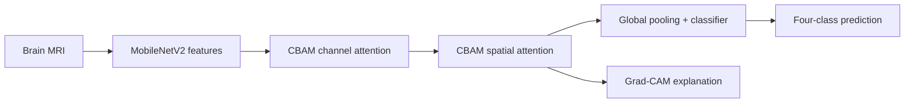

<div align="center">

# Interpretable and Efficient Brain Tumor MRI Classification

### CerebriLite-CAM and NeuroEffiNet research artifacts

[](https://www.python.org/)
[](https://pytorch.org/)
[](https://github.com/pkhunter47)

</div>

## Overview

This repository groups two closely related brain-MRI studies that share the same four-class dataset and experimental foundation:

- **CerebriLite-CAM** — a lightweight MobileNetV2 model enhanced with CBAM attention and Grad-CAM interpretability.
- **NeuroEffiNet** — an accuracy–efficiency comparison of MobileNetV2, ResNet50, VGG16, and EfficientNet-B0.

Keeping the studies together prevents duplicate code while making their different research questions clear.

## Task and dataset

The experiments classify MRI images into four categories:

1. Glioma
2. Meningioma
3. Pituitary tumor
4. No tumor

The uploaded experiment uses a public Kaggle brain-tumor dataset containing **21,672 images**, divided into 17,337 training, 2,167 validation, and 2,168 test images.

## CerebriLite-CAM



The proposed notebook reports approximately **97.05% test accuracy, precision, recall, and F1-score**, using about **2.43 million parameters**. These values belong to the saved experiment snapshot and should be rechecked after a clean rerun.

### Conference presentation

**CerebriLite-CAM** (Paper ID 634) was presented at the **IEEE 3rd International Conference on Computing, Applications and Systems (COMPAS 2026)**, held on **9–10 October 2026** at the University of Dhaka, Bangladesh.

The presentation certificate will be added here later.

## NeuroEffiNet comparison

The baseline notebook evaluates transfer-learning backbones under a common data pipeline and records predictive performance, trainable parameters, model size, and inference time. This supports model selection based on both accuracy and deployment cost.

## Repository contents

```text
brain-tumor-mri-research/
├── notebooks/
│   ├── cerebrilite_cam.ipynb
│   └── baseline_models.ipynb
├── requirements.txt
└── README.md
```

The notebooks were sanitized for public release: saved outputs, runtime state, and displayed credentials were removed.

## Run in Colab

Open a notebook in Google Colab, select a GPU runtime, configure Kaggle access privately, and run the cells in order. Never place `kaggle.json` or an API token inside the repository.

## Reproducibility notes

- Preserve the exact image-level split manifest before comparing models.
- Fit augmentation and class weighting using training data only.
- Use validation data for checkpoint selection and hyperparameter decisions.
- Evaluate the test set only after the model is frozen.
- Report macro metrics and class-wise confusion, not accuracy alone.
- External clinical validation is required before any deployment claim.

## Responsible-use notice

This code is an academic research artifact, not a medical device. It must not be used as a substitute for radiological assessment.

## Contact

**Protik Biswas** · [GitHub](https://github.com/pkhunter47) · [LinkedIn](https://www.linkedin.com/in/protik-biswas-83001827b/) · [Email](mailto:protikbiswas3099@gmail.com)
